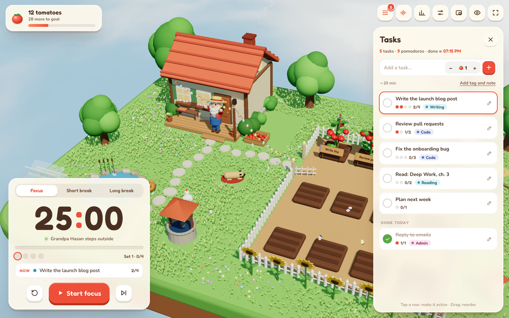
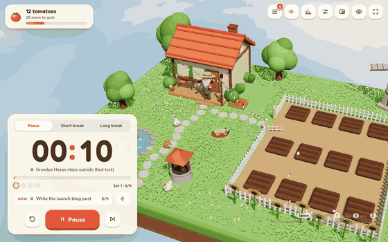
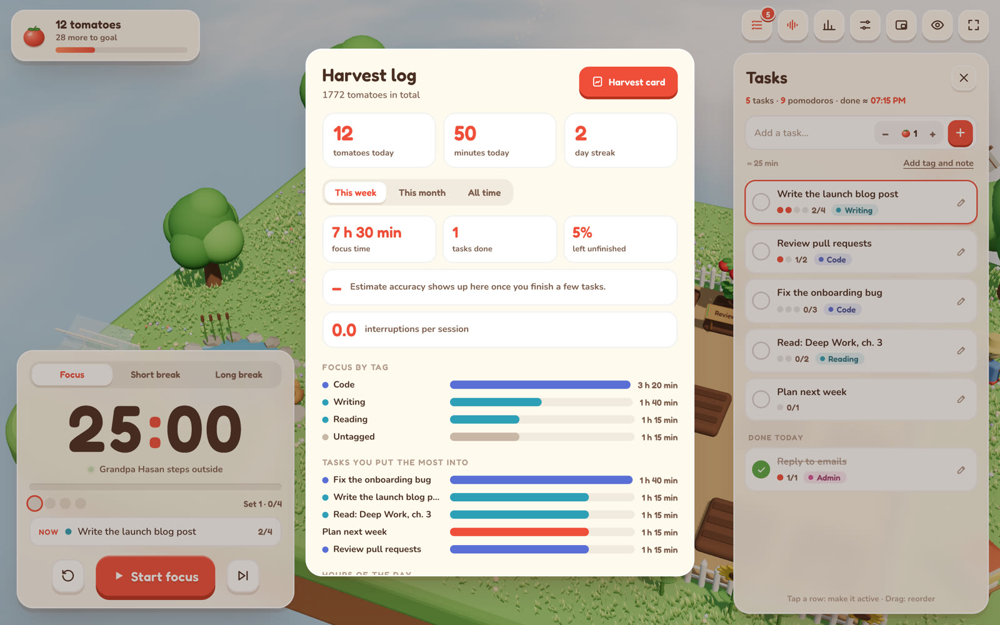
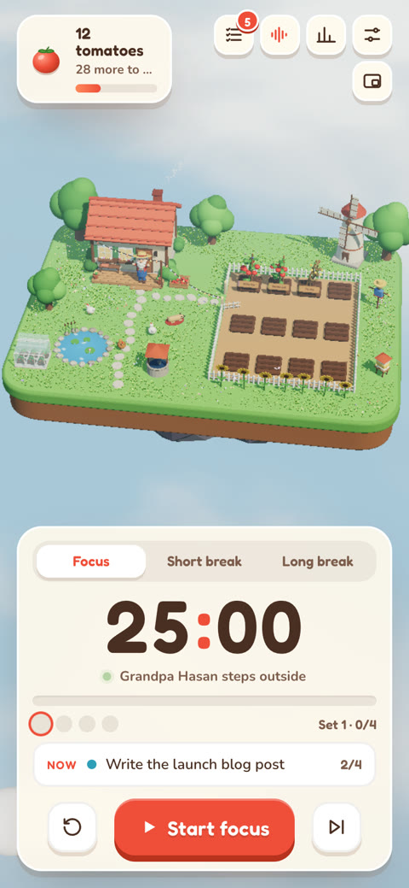
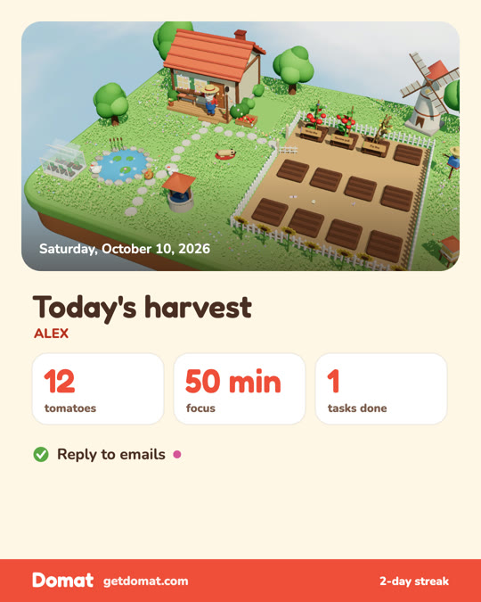

<div align="center">

# 🍅 Domat

**You focus. Grandpa Hasan grows the tomatoes.**

A Pomodoro timer with a task list, set on a tiny 3D farm.<br>
Every focus session plants a seedling labeled with the task you're working on. On your break, the tomatoes are ready to pick.

**[Try it at getdomat.com →](https://getdomat.com)**

If Domat helps you focus, a ⭐ helps other people find it.

[](LICENSE)


[Türkçe](README.tr.md)



</div>

## Why

Most Pomodoro apps are a countdown and a beep. Domat gives you a small world that responds to your focus. Grandpa Hasan walks
out, hoes the soil and plants a seed for the task you're on. When the session ends, the plant is ripe, and the farm keeps growing
as your harvest adds up. The farm is there to make starting the next session a little easier.

<div align="center">

<br><sub>One focus round, sped up with the built-in fast-test mode.</sub>
</div>

## Features

**Tasks**
- Tasks with pomodoro estimates (1–10), tags, notes, drag-to-reorder, and daily or weekday repeats.
- Each task shows its progress (`2/4 🍅`), and the list shows the whole day: `5 tasks · 9 pomodoros · done ≈ 7:15 PM`.
- The active task stays pinned to the timer. When its estimate runs out, Domat asks: *done, or one more pomodoro?*
- Each seedling gets a small wooden sign with the task name and a ribbon in the tag's color.

**Harvest log**
- Focus time by tag and by task, your most productive hours, a 12-month heatmap, streaks and an interruption count.
- **Estimate accuracy**, e.g. *"You underestimate your tasks by 29% on average."*
- A shareable **harvest card**: today's farm, tomatoes, focus time and finished tasks in one 1080×1350 image.

**The farm**
- It grows with your all-time harvest: a beehive, more garden beds, a well, a dog and a greenhouse.
- Tagged tasks grow different tomato varieties (pink, yellow, black, cherry), and you can collect them all.
- Seasons follow the calendar or can be set by hand: spring blossoms, autumn leaves, winter snow.
- Halloween (Oct 22 – Nov 1): carved pumpkins that glow at dusk, bats, a friendly ghost to tap, a witch hat for Grandpa Hasan, and a small pumpkin under every seedling at harvest. Turn it off in Settings.
- Ambient sound and effects have separate volume controls. There is an optional focus tick and a choice of end-of-focus chime.

**Everywhere**
- Installable PWA that works offline. On iPhone, add it to your Home Screen.
- A mini timer that floats over your other windows (Document Picture-in-Picture, Chrome).
- English and Turkish, covering the whole interface and every line Grandpa Hasan says.
- Graphics quality adjusts itself on slower devices.

<table>
<tr>
<td width="62%"></td>
<td width="19%"></td>
<td width="19%"></td>
</tr>
</table>

## Privacy

Your data lives on your device and nowhere else. Domat has no account, no analytics and no cookies, and it makes no requests to
any server of its own. Tasks, sessions and settings are kept in your browser's `localStorage`. Download a JSON backup from
Settings now and then, or export your sessions as CSV.

## Keyboard shortcuts

| Key | Action | Key | Action |
| --- | --- | --- | --- |
| `Space` | Start / pause | `S` | Skip |
| `T` | Tasks | `R` | Reset |
| `N` | New task | `Z` | Zen mode |
| `1`–`9` | Set active task | `F` | Full screen |
| `D` | Log a distraction | `M` | Mute |
| `P` | Mini timer | `A` | Ambient sound |

## Run it locally

No build step, no dependencies to install:

```bash
git clone https://github.com/ayhankorkmaz/domat.git
cd domat
python3 -m http.server 8000
# open http://localhost:8000
```

`index.html` won't run from a double-click because it needs a server. If you want one file, run
`python3 tools/build-single.py` to build a self-contained `Domat.html` with everything inlined. In that mode,
offline install and the mini timer are not available.

## How it's built

Plain HTML, CSS and JavaScript, about 3,000 lines in total. There is no framework and no bundler.

```
index.html           markup
css/app.css          styles
js/app.js            the farm (Three.js), the timer, tasks, stats and the harvest card
js/i18n.js           every string, in English and Turkish
vendor/              Three.js r170, cannon-es (physics), vendored, no CDN
fonts/               Fredoka and Nunito, self-hosted
sw.js                service worker, generated by tools/make-sw.py
tools/               build-dist.py (deploy folder), build-single.py (one-file build), make-sw.py
tests/               headless Chrome tests (Playwright)
```

- The scene is built entirely in code. There are no 3D model files: the house, Grandpa Hasan, the animals and the plants are all
  assembled from Three.js primitives.
- After you change or add files, run `python3 tools/make-sw.py`. It updates the offline cache list and the cache version.
- **Tests:** start a server on port 8767 (`python3 -m http.server 8767`), then run, for example, `node tests/e2e.mjs`.
  You need `playwright-core` and Google Chrome.
- **Deploy:** the site is fully static. `python3 tools/build-dist.py` writes `dist/`, and you can host it anywhere.
  getdomat.com runs on Cloudflare Pages (`wrangler pages deploy dist --project-name domat`).

## Origin

Domat began as [Domates Bahçesi](https://github.com/ayhankorkmaz/domates-bahcesi) ("Tomato Garden"), a single-file Three.js
experiment. This repo is the full rewrite, with tasks, stats, seasons, a growing farm, offline support and two languages.

## Contributing

Issues and pull requests are welcome. A good first contribution is a translation: all strings live in `js/i18n.js`.

## License

[MIT](LICENSE) © Ayhan Korkmaz · [ayhankorkmaz.com](https://ayhankorkmaz.com) · [@ayhankorkmaz_](https://x.com/ayhankorkmaz_)

Three.js and cannon-es are MIT licensed. Fredoka and Nunito are licensed under the SIL Open Font License.
